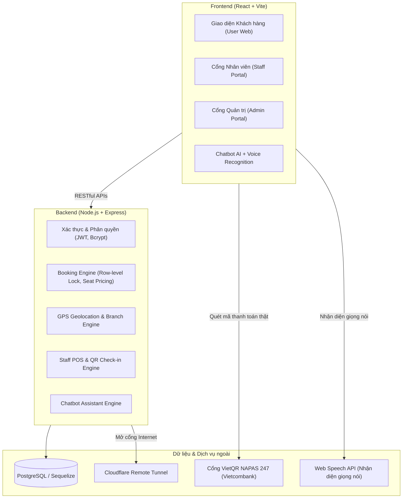
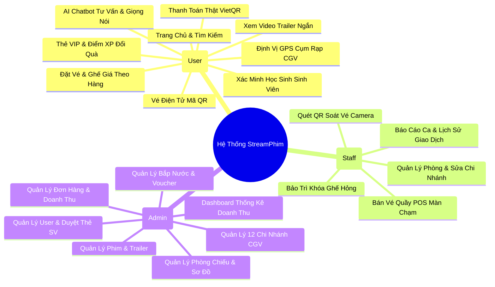
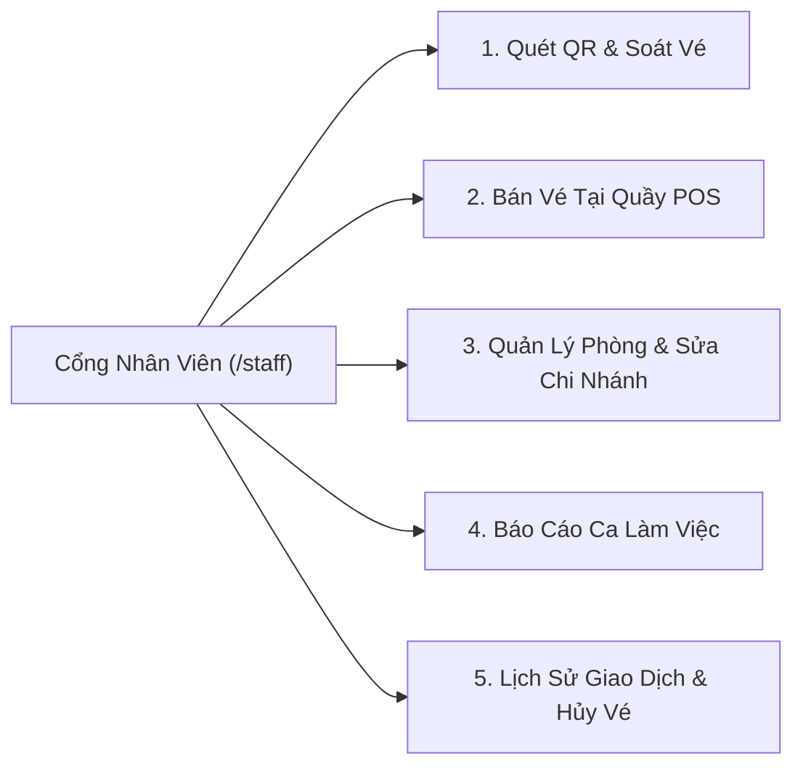

# BÁO CÁO TOÀN DIỆN HỆ THỐNG WEBSITE XEM PHIM & ĐẶT VÉ RẠP CHIẾU PHIM (STREAMPHIM)

---

## 📌 I. TỔNG QUAN HỆ THỐNG

### 1. Giới thiệu dự án
* **Tên dự án:** StreamPhim - Nền tảng xem phim trực tuyến & Hệ thống quản lý đặt vé rạp chiếu phim đa chi nhánh.
* **Mục tiêu:** Cung cấp trải nghiệm toàn diện cho người dùng từ việc tra cứu phim, xem trailer video, nhận tư vấn phim bằng AI (hỗ trợ giọng nói), tìm rạp CGV gần nhất qua GPS, đặt vé với sơ đồ ghế định giá theo hàng, thanh toán chuyển khoản **VietQR ngân hàng thật**, tích lũy điểm thưởng thành viên và soát vé tại rạp.
* **Đối tượng sử dụng:**
  1. **Khách hàng (Customer / User):** Khám phá phim, xem trailer, đặt vé online, thanh toán VietQR, tích điểm XP, đổi quà, quét mã QR vé.
  2. **Nhân viên rạp (Staff):** Soát vé bằng mã QR camera, bán vé quầy POS, quản lý phòng chiếu và bảo trì ghế hỏng, báo cáo doanh thu ca trực.
  3. **Quản trị viên (Admin):** Quản lý toàn bộ hệ thống (doanh thu, đơn hàng, phim, phòng chiếu, chi nhánh CGV, người dùng, voucher, bắp nước, phê duyệt sinh viên).

---

### 2. Kiến trúc & Công nghệ sử dụng

* **Frontend:**
  * **React 18** kết hợp công cụ đóng gói siêu tốc **Vite**.
  * Giao diện người dùng: **Ant Design 5 (AntD)** kết hợp **TailwindCSS** và **SCSS Modules**.
  * Quản lý trạng thái & dữ liệu: **React Hooks**, **Axios** (kèm Interceptor tự động gán Token), **Dayjs / Moment.js**.
  * Biểu đồ & Tương tác: **Recharts**, **Lucide Icons**, **Ant Icons**, **Canvas Confetti**.
* **Backend:**
  * Nền tảng: **Node.js** với Framework **Express.js**.
  * Cơ sở dữ liệu: **PostgreSQL** kết hợp **Sequelize ORM** (hỗ trợ tự động đồng bộ lược đồ bảng, Migration và Indexing).
  * Bảo mật: **JSON Web Token (JWT)**, **Bcrypt** băm mật khẩu, Middleware kiểm soát vai trò (`checkAuth`).
* **Dịch vụ & Tiện ích tích hợp:**
  * **VietQR NAPAS 247:** Chuẩn mã QR thanh toán quốc gia liên ngân hàng (Vietcombank STK `1336991507`).
  * **Web Speech Recognition API:** Nhận diện giọng nói tiếng Việt thành văn bản.
  * **Haversine Geolocation Algorithm:** Tính toán khoảng cách địa lý GPS giữa khách hàng và các cụm rạp.
  * **Cloudflare Tunnel:** Mở đường link công khai để truy cập website từ điện thoại và thiết bị ngoài Internet.

---

## 🎬 II. CÁC PHÂN HỆ VÀ CHỨC NĂNG CHI TIẾT

---

### 1. PHÂN HỆ KHÁCH HÀNG (USER / CLIENT)

#### 1.1. Trang Chủ & Khám Phá Phim
* **Banner Hero tương tác:** Trình diễn các bộ phim điện ảnh bom tấn nổi bật kèm hiệu ứng chuyển động mượt mà.
* **Bộ lọc thông minh:** Lọc phim theo thể loại (Hành động, Kinh dị, Tình cảm, Hoạt hình...), lọc phim chiếu rạp và phim trực tuyến.
* **Tìm kiếm thời gian thực:** Nhập từ khóa phim, kết quả phản hồi tức thì.
* **Xem Trailer Video Ngắn:**
  * Mỗi poster phim đều tích hợp nút **`▶ Xem Trailer`**.
  * Khi bấm vào, một hộp thoại Popup sắc nét hiển thị đoạn trailer giới thiệu phim trực tiếp trên màn hình, giúp khách xem nhanh nội dung trước khi quyết định đặt vé.
  * Tích hợp chế độ phát **`youtube-nocookie`** bảo mật và chống chặn iframe, bổ sung nút **`▶ Mở trên YouTube`** để mở nhanh trên App YouTube và công cụ tìm kiếm tự động khi video đang cập nhật.

#### 1.2. Hệ Thống Định Vị Cụm Rạp CGV Qua GPS
* **Định vị vị trí khách hàng:** Tích hợp nút **`📍 Mở vị trí tìm rạp gần nhất`**, sử dụng định vị GPS trình duyệt để xác định tọa độ hiện tại của người dùng.
* **Thuật toán Haversine:** Tự động tính khoảng cách chính xác theo đường chim bay (km) từ vị trí người dùng đến tất cả các rạp CGV trên cả nước.
* **Gợi ý rạp gần nhất:** Đánh dấu huy hiệu vàng `"🌟 Gần bạn nhất (Cách x.x km)"` lên chi nhánh tối ưu nhất.
* **Bộ lọc tỉnh thành:** Tab phân loại cụm rạp theo từng khu vực: Hà Nội, TP. Hồ Chí Minh, Đà Nẵng, Cần Thơ, Hải Phòng, Đồng Nai, Bình Dương...
* **Thông tin rạp & Dẫn đường Google Maps:** Hiển thị địa chỉ, số hotline, giờ mở cửa và nút mở trực tiếp bản đồ Google Maps dẫn đường đến rạp.

#### 1.3. Trợ Lý Ảo Chatbot AI Tư Vấn Phim & Nhận Diện Giọng Nói
* **Cửa sổ Chatbot nổi:** Nằm ở góc phải màn hình, giao diện chuẩn hiện đại.
* **Tư vấn thông minh:** Trả lời các câu hỏi về:
  * Phim nào đang hot, phim hành động/tình cảm nào đáng xem.
  * Lịch chiếu, thời lượng, đạo diễn, diễn viên, tóm tắt cốt truyện.
  * Giá vé từng hàng ghế, chính sách giảm giá học sinh - sinh viên.
* **Dữ liệu chuẩn xác:** Chatbot lấy dữ liệu trực tiếp từ cơ sở dữ liệu rạp, không bịa đặt nội dung.
* **Ghi âm giọng nói (Voice-to-Text):** Tích hợp nút micro `🎙️`, cho phép người cao tuổi hoặc trẻ em không quen gõ chữ chỉ cần nói vào micro, hệ thống tự động phiên âm tiếng Việt và gửi cho Chatbot giải đáp.
* **Liên kết đặt vé tức thì:** Gợi ý các nút bấm chuyển nhanh vào trang đặt vé của từng phim.

#### 1.4. Quy Trình Đặt Vé & Chọn Ghế Giá Theo Hàng (`/book-movie/:id`)
* **Chọn ngày chiếu:** Hiển thị 30 ngày sắp tới với thứ trong tuần tiếng Việt rõ ràng.
* **Chọn suất chiếu:** Lựa chọn các khung giờ chiếu trong ngày (10:00, 12:30, 15:00, 17:30, 20:00, 22:30...).
* **Sơ đồ ghế thông minh & Định giá theo từng hàng ghế:**
  * **Hàng A, B (Ghế Tiêu Chuẩn / Standard):** 60.000 VNĐ - Thích hợp cho khách xem gần màn hình, giá tiết kiệm.
  * **Hàng C, D, E, F (Ghế VIP Trung Tâm):** 85.000 VNĐ - Tầm nhìn chuẩn mắt, âm thanh vòm hoàn hảo nhất.
  * **Hàng G, H (Ghế Sweetbox / Đôi Cao Cấp):** 110.000 VNĐ - Hàng ghế sau cùng, không gian riêng tư, thoải mái.
* **Trạng thái ghế trực quan:** Phân biệt rõ ghế đang chọn (viền xanh neon), ghế trống, ghế đã bán (màu xám tối) và ghế đang bảo trì (màu cam kẻ sọc `🔧`).
* **Cơ chế chống trùng vé (Race-Condition Protection):**
  * Sử dụng giao dịch cơ sở dữ liệu với khóa dòng cấp cao (`Row-Level Lock`).
  * Nếu 2 người cùng bấm đặt một chiếc vé cuối cùng trong cùng 1 mili-giây, hệ thống ưu tiên người nhấn trước và thông báo lịch sự cho người đến sau chọn ghế khác, loại bỏ hoàn toàn rủi ro bán trùng ghế.
* **Dịch vụ Bắp & Nước đi kèm:** Khách hàng có thể chọn thêm combo bắp phô mai, caramel, nước ngọt Coca, Sprite với số lượng tùy ý.
* **Mã giảm giá (Voucher):** Ô nhập mã khuyến mãi, hệ thống tự động kiểm tra điều kiện áp dụng, giảm trừ trực tiếp vào hóa đơn.

#### 1.5. Hệ Thống Thanh Toán Thật 100% (VietQR Vietcombank & Ví MoMo)
* **Chuyển đổi hoàn toàn từ thanh toán ảo sang thanh toán thật 100%:**
  * **Kênh 1: Ngân Hàng Vietcombank (Chuẩn VietQR NAPAS 247)**
    * Ngân hàng: **Vietcombank (Ngân hàng TMCP Ngoại Thương Việt Nam)**
    * Số tài khoản (STK): `1336991507`
    * Chủ tài khoản: **LẠI VĂN TÚ**
    * Cơ chế: Tự động tạo mã QR chuẩn VietQR động với số tiền và nội dung chuyển khoản tự điền.
  * **Kênh 2: Ví Điện Tử MoMo Thật**
    * Đơn vị thụ hưởng: **Ví Điện Tử MoMo (CTCP Dịch Vụ Di Động Trực Tuyến)**
    * Mã định danh tài khoản MoMo: `PSP2626913300000151`
    * Mã BIN ngân hàng liên kết: `971025` (MoMo)
    * Chủ tài khoản: **LẠI VĂN TÚ**
    * Cơ chế: Tự động tạo mã QR MoMo đa năng kết nối NAPAS 247, tương thích tuyệt đối khi quét bằng ứng dụng MoMo lẫn mọi App ngân hàng di động.
* **Trải nghiệm thanh toán ưu việt:**
  * Tự động sinh mã **QR Vietcombank hoặc MoMo thật**, mã hóa chính xác số tiền vé và mã đơn riêng biệt (`VEPHIM SPxxxxxx`).
  * Khách chỉ cần mở **bất kỳ App Ngân hàng** (VCB Digibank, MB, Techcombank, BIDV, VPBank, Agribank...) hoặc ví **MoMo** ➔ chọn Quét QR ➔ Số tiền, người nhận và nội dung tự động điền đầy đủ.
  * Cung cấp các nút **Sao chép (Copy) 1-chạm** cho STK, Tên chủ TK, Số tiền, Nội dung chuyển khoản.
  * Đồng hồ đếm ngược giao dịch an toàn 15:00 phút.
  * Nút **`✅ TÔI ĐÃ CHUYỂN TIỀN THÀNH CÔNG`**: Sau khi chuyển tiền, khách bấm xác nhận ➔ Hệ thống ghi nhận vé thành công với khóa chống trùng ghế (Row-level lock), lưu vào cơ sở dữ liệu, cộng điểm thưởng XP (+100 XP/vé) và chuyển ngay đến trang nhận vé.
  * Hỗ trợ nút **`Mở ảnh QR gốc`** để lưu ảnh mã QR vào album điện thoại.

#### 1.6. Vé Điện Tử & Mã QR Check-in (`/payment-success/:id`)
* **Giao diện vé điện tử cao cấp:** Hiển thị thông báo chúc mừng đặt vé thành công.
* **Mã QR vé độc quyền:** Mã QR chứa mã vé để nhân viên quét khi vào rạp.
* **Chi tiết đầy đủ:** Tên phim, Rạp/Chi nhánh, Phòng chiếu, Suất chiếu, Ghế ngồi, Danh sách combo bắp nước, Tổng tiền đã thanh toán qua Vietcombank.
* **Lưu trữ tự động:** Tự động lưu vé vào chuông thông báo cá nhân và lịch sử đặt vé.

#### 1.7. Đánh Giá Phim Sau Khi Xem & Cộng Điểm XP
* **Thông báo nhắc nhở:** Sau khi xem phim, màn hình hiển thị lời mời đánh giá trải nghiệm xem phim.
* **Đánh giá 1 - 5 sao:** Chấm điểm số sao và viết lời nhận xét cảm nhận về bộ phim.
* **Phần thưởng kinh nghiệm:** Mỗi lượt đánh giá thành công được **cộng ngay +50 XP** vào tài khoản thành viên.

#### 1.8. Thẻ Thành Viên VIP & Đổi Quà Điểm Kinh Nghiệm (XP Loyalty Card)
* **Hệ thống cấp bậc thành viên (VIP Tiers):**
  * **Đồng (Bronze):** Thành viên mới đăng ký.
  * **Bạc (Silver):** Đạt từ 500 XP (Ưu đãi vé giảm 5%).
  * **Vàng (Gold):** Đạt từ 1.500 XP (Tặng bắp nước miễn phí mỗi tháng).
  * **Kim Cương (Diamond):** Đạt từ 3.000 XP (Ưu đãi tối đa và phòng chờ VIP).
* **Cơ chế tích điểm:** Mua 1 vé xem phim = `+100 XP`, Đánh giá phim = `+50 XP`.
* **Cửa hàng đổi quà (Reward Redemption):**
  * 100 XP ➔ Đổi ngay 1 Ly nước ngọt Coca/Sprite miễn phí.
  * 200 XP ➔ Đổi ngay 1 Gói bắp rang bơ phô mai nóng giòn.
  * 350 XP ➔ Đổi 1 Voucher giảm giá 20.000 VNĐ cho lần mua vé sau.
  * 600 XP ➔ Đổi 1 Voucher giảm giá 50.000 VNĐ.
  * 1.000 XP ➔ Đổi 1 Vé xem phim miễn phí (Free Movie Ticket).

#### 1.9. Form Xác Minh Học Sinh - Sinh Viên (Student Verification)
* **Giao diện đăng ký:** Nằm trong mục Hồ sơ cá nhân (`/info-user`).
* **Hồ sơ gửi duyệt:** Nhập Tên trường, Mã sinh viên/học sinh, Niên khóa và tải lên Ảnh thẻ học sinh/sinh viên.
* **Đặc quyền sau khi duyệt:**
  * Đồng giá vé xem phim chỉ **55.000 VNĐ** (áp dụng tất cả các ngày trong tuần).
  * Giảm giá trực tiếp 20% cho tất cả các combo bắp nước tại rạp.

---

### 2. PHÂN HỆ NHÂN VIÊN RẠP (STAFF PORTAL - `/staff`)

#### 2.1. Quét QR & Soát Vé (QrCheckIn)
* **Soát vé qua Camera:** Hỗ trợ quét mã QR vé của khách qua camera điện thoại hoặc webcam máy tính.
* **Nhập mã vé thủ công:** Dành cho trường hợp khách không tiện mở mã QR.
* **Xác thực trạng thái thông minh:**
  * *Vé hợp lệ:* Hiển thị màu xanh lá kèm tên phim, phòng, số ghế và chúc khách xem phim vui vẻ.
  * *Vé đã soát trước đó:* Báo động màu đỏ kèm mốc thời gian đã soát để ngăn chặn việc chụp ảnh vé cho người khác vào xem lần hai.
  * *Vé chưa thanh toán:* Cảnh báo vé chưa hợp lệ.
* **Ghi nhận lịch sử check-in:** Gắn mã nhân viên soát vé và giờ soát vé chính xác vào cơ sở dữ liệu.

#### 2.2. Bán Vé Tại Quầy POS Màn Chạm (PosTicket)
* **Giao diện cảm ứng siêu tốc:** Thiết kế tối ưu cho nhân viên thu ngân tại rạp.
* **Chọn chi nhánh rạp:** Chọn cụm rạp CGV đang đứng ca làm việc.
* **Thao tác 1-chạm:** Chọn phim, ngày chiếu, suất chiếu, ghế ngồi trực tiếp trên sơ đồ phòng.
* **Chọn bắp nước:** Bổ sung bắp rang bơ, nước ngọt vào đơn hàng.
* **Nhập thông tin khách hàng:** Nhập tên và SĐT (nếu khách đã có tài khoản, hệ thống tự động tích điểm thưởng XP cho khách).
* **Thanh toán tại quầy đa dạng:**
  * *Tiền mặt:* Ô nhập tiền khách đưa, tự động tính tiền thừa cần trả khách.
  * *Chuyển khoản VietQR thật:* Hiển thị ngay mã VietQR Vietcombank STK `1336991507` và số tiền vé trên màn hình POS để khách quét chuyển tiền thật.
  * *Thanh toán Ví MoMo thật:* Hiển thị trực tiếp mã MoMo QR thật STK `PSP2626913300000151` (Chủ TK: LẠI VĂN TÚ) để khách quét thanh toán ngay tại quầy.
* **In vé & Xuất biên lai nhiệt:** Mẫu vé in chuẩn rạp chiếu phim với đầy đủ thông tin xuất chiếu.

#### 2.3. Quản Lý Phòng Chiếu & Sửa Chi Nhánh Rạp (SeatMaintenance)
* **Thanh thông tin phòng:** Hiển thị Tên phòng, Chi nhánh CGV trực thuộc, Loại phòng (`2D`, `3D`, `IMAX Laser`, `4DX`), Sức chứa ghế.
* **Chức năng Sửa Chi Nhánh Cho Phòng Chiếu:**
  * Cho phép nhân viên/quản lý rạp chuyển phòng chiếu sang bất kỳ chi nhánh CGV nào trong số 12 chi nhánh trên cả nước.
  * Hỗ trợ tìm kiếm chi nhánh theo tên rạp, tỉnh thành.
  * Xem trước thông tin chi nhánh: địa chỉ, hotline, giờ mở cửa.
  * Cho phép đổi tên phòng và định dạng chiếu (`2D`, `3D`, `IMAX`, `4DX`).
* **Modal Danh Sách Tất Cả Phòng:** Bảng tổng hợp tất cả phòng chiếu kèm nút *Sửa Chi Nhánh* và *Chọn Quản Lý Sơ Đồ* nhanh.
* **Khóa Ghế Bảo Trì:** Đánh dấu các ghế hỏng chân, hỏng đệm hoặc cần vệ sinh để khóa lại, ngăn không cho khách đặt nhầm trên trang web. Sau khi sửa chữa xong, nhấn *"Hoàn tất bảo trì"* để mở lại ghế.

#### 2.4. Báo Cáo Ca & Lịch Sử Giao Dịch
* **Báo cáo ca làm việc:** Thống kê tổng doanh thu ca trực, phân loại số tiền thu từ tiền mặt và chuyển khoản QR, số lượng vé đã xuất.
* **Lịch sử giao dịch:** Tra cứu lại các đơn vé đã bán tại quầy, hỗ trợ in lại vé hoặc hủy vé khi khách có yêu cầu đổi trả hợp lệ.

---

### 3. PHÂN HỆ QUẢN TRỊ VIÊN (ADMIN PORTAL - `/admin`)

#### 3.1. Dashboard Thống Kê Doanh Thu & Chỉ Số
* **Thống kê tổng quan:** Tổng doanh thu, tổng số vé bán ra, tổng người dùng, tỷ lệ lấp đầy rạp.
* **Biểu đồ trực quan:**
  * Biểu đồ cột/đường doanh thu theo ngày, tuần, tháng.
  * Biểu đồ tròn cơ cấu doanh thu: Tỷ trọng tiền vé xem phim so với tiền bán bắp nước combo.

#### 3.2. Quản Lý Đơn Đặt Vé (ManagerOrder)
* Bảng danh sách toàn bộ các giao dịch đặt vé trên toàn hệ thống (cả đặt online lẫn tại quầy POS).
* Lọc đơn hàng theo trạng thái (`success`, `pending`, `canceled`).
* Xem chi tiết từng đơn hàng: Họ tên khách hàng, số điện thoại, phim, rạp chiếu, danh sách ghế, phương thức thanh toán, thời gian đặt.

#### 3.3. Quản Lý Phim & Video Trailer (ManagerProduct)
* Thêm mới, chỉnh sửa và xóa phim.
* Tải lên ảnh Poster, ảnh Banner, Video Trailer ngắn, Giá vé cơ bản, Đạo diễn, Diễn viên, Thời lượng, Giới hạn độ tuổi.
* Bật / Tắt trạng thái phim đang chiếu hoặc sắp chiếu.

#### 3.4. Quản Lý Phòng Chiếu (ManagerRoom)
* Quản lý danh sách phòng chiếu trên toàn bộ hệ thống.
* Gán phòng chiếu trực thuộc cụm rạp CGV thông qua menu chọn chi nhánh thông minh.
* Tùy chỉnh kích thước hàng ghế (Số hàng A-Z, Số ghế mỗi hàng) và định dạng phòng (`2D`, `3D`, `IMAX`, `4DX`).
* Xem trước sơ đồ chỗ ngồi thời gian thực (Seat Preview).

#### 3.5. Quản Lý Cụm Rạp CGV (ManagerBranches)
* Quản lý 12 chi nhánh rạp CGV trên cả nước (Hà Nội, TP.HCM, Đà Nẵng, Cần Thơ, Hải Phòng, Đồng Nai, Bình Dương...).
* Cập nhật Tên rạp, Thương hiệu, Địa chỉ, Tỉnh thành, Số điện thoại, Giờ mở cửa, Ảnh đại diện, và **Tọa độ GPS (Vĩ độ - Latitude, Kinh độ - Longitude)** phục vụ tính khoảng cách.

#### 3.6. Quản Lý Người Dùng & Duyệt Thẻ Sinh Viên (ManagerUser)
* Danh sách toàn bộ tài khoản người dùng trong hệ thống.
* Phân quyền vai trò: `user` (Khách hàng), `staff` (Nhân viên), `admin` (Quản trị viên).
* Theo dõi điểm kinh nghiệm (XP) và Hạng thẻ thành viên của từng khách hàng.
* **Khu vực duyệt hồ sơ Học sinh - Sinh viên:**
  * Xem ảnh thẻ học sinh/sinh viên gửi lên.
  * Bấm nút **Duyệt (Approve)** hoặc **Từ chối (Reject)**. Khi được duyệt, tài khoản khách hàng tự động được kích hoạt chính sách vé 55k.

#### 3.7. Quản Lý Bắp Nước & Mã Khuyến Mãi (Service & Voucher)
* Thêm các combo bắp rang bơ, nước ngọt, đặt giá bán và hình ảnh.
* Tạo các mã giảm giá (Voucher), quy định mức giảm (theo % hoặc số tiền cố định), giá trị đơn hàng tối thiểu và số lượt sử dụng tối đa.

---

### 4. BẢO MẬT & HẠ TẦNG KỸ THUẬT

| Hạng mục | Cơ chế thực hiện | Lợi ích mang lại |
| :--- | :--- | :--- |
| **Bảo vệ Route (ProtectedRoute)** | Kiểm tra Token và vai trò (`role`) ở cả Frontend và Backend | Chặn hoàn toàn việc người dùng thường truy cập trái phép vào `/admin` hoặc `/staff`. |
| **Mã hóa mật khẩu** | Thư viện `bcrypt` với muối băm (salt rounds) | Mật khẩu được mã hóa an toàn, chống lộ lọt trong cơ sở dữ liệu. |
| **Chống bán trùng ghế** | Giao dịch SQL kèm khóa hàng (`Row-Level Lock`) | Đảm bảo tính nhất quán tuyệt đối khi hàng ngàn khách cùng tranh mua vé cuối cùng. |
| **Thanh toán VietQR thật** | Chuẩn NAPAS 247 mã hóa trực tiếp STK Vietcombank `1336991507` | Tiền vé chuyển thẳng vào tài khoản ngân hàng thực tế, không qua trung gian ảo. |
| **Remote Tunnel** | Tích hợp Cloudflare Tunnel tự động | Cho phép người khác ở bất cứ đâu trên Internet truy cập website để kiểm thử và trải nghiệm trên điện thoại. |

---

## 📊 III. BẢNG TỔNG HỢP CÁC ENDPOINT API CHÍNH

### 1. Phân hệ Phim & Suất Chiếu
* `GET /api/movie/all`: Lấy danh sách tất cả phim.
* `GET /api/movie/detail?id=...`: Lấy thông tin chi tiết phim và trailer video.
* `POST /api/movie/create`: Tạo phim mới (Admin).
* `POST /api/movie/update`: Cập nhật thông tin phim.

### 2. Phân hệ Chi Nhánh Rạp & Phòng Chiếu
* `GET /api/cinema-branch/all`: Lấy danh sách 12 cụm rạp CGV kèm tọa độ GPS.
* `POST /api/cinema-branch/create`: Tạo chi nhánh rạp mới (Admin).
* `GET /api/room/all`: Lấy danh sách tất cả phòng chiếu.
* `POST /api/room/create`: Tạo phòng chiếu mới.
* `POST /api/room/update`: Cập nhật thông tin và chi nhánh của phòng chiếu.
* `POST /api/staff/room-branch`: Cập nhật chi nhánh rạp cho phòng chiếu từ phía nhân viên.

### 3. Phân hệ Đặt Vé & Thanh Toán
* `POST /api/payments/create`: Tạo đơn đặt vé, khóa ghế chống trùng, hỗ trợ phương thức `vietqr`, `momo` và cộng điểm XP.
* `GET /api/payments/bank-config`: Lấy thông tin tài khoản ngân hàng thụ hưởng (Vietcombank - `1336991507`).
* `GET /api/payments/momo-config`: Lấy thông tin tài khoản Ví MoMo thụ hưởng (`PSP2626913300000151` - `LẠI VĂN TÚ`).
* `GET /api/payments/detail?id=...`: Lấy thông tin hóa đơn và vé điện tử.
* `GET /api/payments/user`: Lấy lịch sử mua vé của người dùng đang đăng nhập.

### 4. Phân hệ Khách Hàng & Điểm Thưởng
* `GET /api/user/xp-info`: Lấy thông tin điểm XP, hạng thành viên VIP và lịch sử giao dịch điểm.
* `POST /api/user/redeem-reward`: Đổi quà tặng (nước, bắp, voucher) bằng điểm XP.
* `POST /api/user/student-verify`: Gửi form xác minh học sinh - sinh viên kèm ảnh thẻ.
* `POST /api/user/approve-student`: Phê duyệt hồ sơ sinh viên (Admin).
* `POST /api/preview-movie/create`: Gửi đánh giá 1-5 sao và nhận +50 XP.

### 5. Phân hệ Nhân Viên (Staff)
* `GET /api/staff/ticket/:code`: Tra cứu thông tin vé qua mã QR.
* `POST /api/staff/check-in`: Xác nhận soát vé cho khách vào phòng chiếu.
* `POST /api/staff/sell-ticket`: Bán vé trực tiếp tại quầy POS.
* `GET /api/staff/rooms`: Lấy danh sách phòng cho nhân viên.
* `POST /api/staff/seat-maintenance`: Khóa hoặc mở lại ghế bảo trì.
* `GET /api/staff/shift-report`: Lấy báo cáo thống kê doanh thu ca trực.

### 6. Phân hệ Trợ Lý Ảo Chatbot AI
* `POST /api/chatbot/message`: Nhận tin nhắn/phiên âm giọng nói từ khách hàng và trả về câu trả lời tư vấn phim rạp chuẩn xác.

---

## 🎯 IV. KẾT LUẬN & ĐÁNH GIÁ

Hệ thống **StreamPhim** hiện tại là một giải pháp hoàn chỉnh, có tính ứng dụng thực tế cao:
1. **Trải nghiệm người dùng:** Giao diện sắc nét chuẩn rạp phim quốc tế, mượt mà trên cả máy tính lẫn điện thoại di động.
2. **Tính thực tiễn:** Thanh toán trực tiếp vào tài khoản ngân hàng thật qua mã VietQR, định vị GPS tìm rạp gần nhất, chatbot hỗ trợ giọng nói cho người cao tuổi.
3. **Độ ổn định & Tin cậy:** Kiểm soát xung đột chỗ ngồi theo thời gian thực (Concurrency Safe), phân quyền 3 lớp chặt chẽ (User - Staff - Admin), mã nguồn đã được đóng gói và đồng bộ lên GitHub an toàn.

